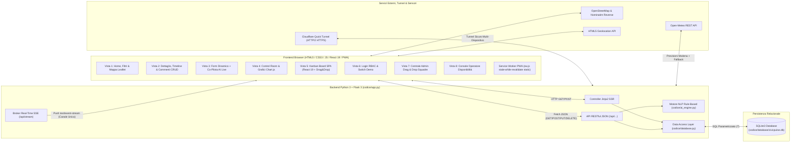
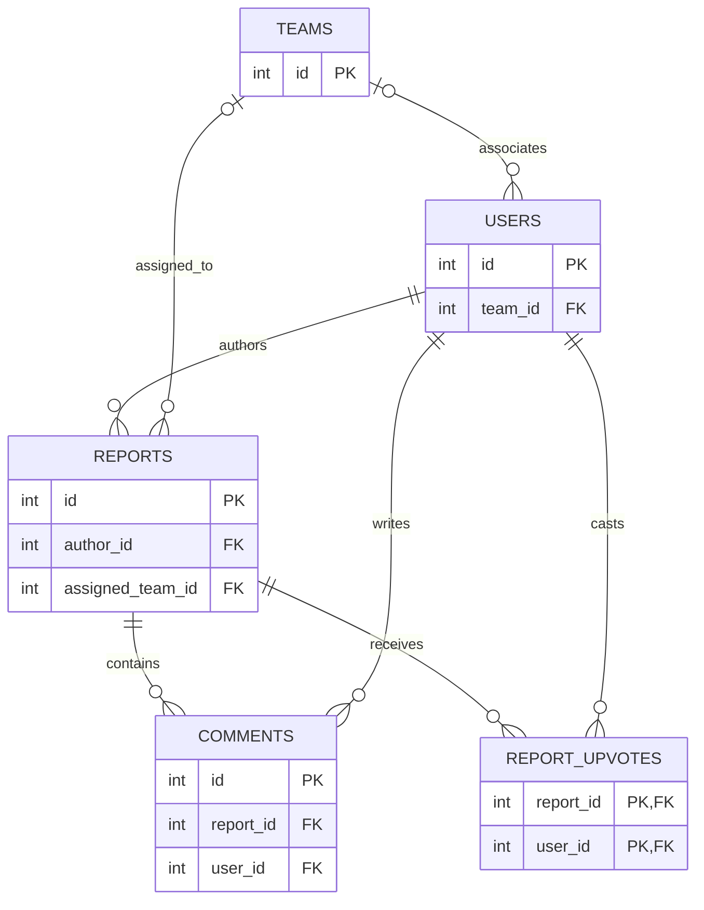

# CivicPulse Modena — Piattaforma Smart City di Crowdsensing Urbano, Auto-Triage AI/NLP e Gestione Interventi Real-Time

> **Progetto Individuale (Tesina) di Tecnologie Web — AA 2026-2027**  
> **Corso Integrato**: Intelligenza Artificiale e Tecnologie Web (6 CFU) — Docente: **Prof.ssa Laura Po**  
> **Università degli Studi di Modena e Reggio Emilia (UNIMORE)** — Dipartimento di Ingegneria "Enzo Ferrari" (DIEF)

---

## Indice
1. [Obiettivo del Progetto e Problema Risolto](#1-obiettivo-del-progetto-e-problema-risolto)
2. [Architettura del Sistema e Stack Tecnologico](#2-architettura-del-sistema-e-stack-tecnologico)
3. [Motivazione Critica delle Scelte Progettuali e Trade-off](#3-motivazione-critica-delle-scelte-progettuali-e-trade-off)
4. [Criterio "Sporcarsi le Mani" (Tecnologie Approfondite in Autonomia)](#4-criterio-sporcarsi-le-mani-tecnologie-approfondite-in-autonomia)
5. [Schema del Database Relazionale (SQLite3) e Funzionalità CRUD](#5-schema-del-database-relazionale-sqlite3-e-funzionalit-crud)
6. [Documentazione Servizi RESTful API](#6-documentazione-servizi-restful-api)
7. [Struttura del Repository, Avvio Rapido e Test Automatici](#7-struttura-del-repository-avvio-rapido-e-test-automatici)
8. [Dichiarazione uso di AI (Template Ufficiale Specifiche AA 2026-27)](#8-dichiarazione-uso-di-ai)

---

## 1. Obiettivo del Progetto e Problema Risolto

Nella gestione della manutenzione urbana (comuni, campus universitari, reti civiche), le segnalazioni dei cittadini relative a **buche stradali, guasti all'illuminazione pubblica, alberi pericolanti, caditoie ostruite o barriere architettoniche** soffrono tradizionalmente di quattro criticità strutturali:
1. **Frammentazione e assenza di georeferenziazione precisa**: segnalazioni inviate via email o telefono prive di coordinate GPS esatte;
2. **Collo di bottiglia nel triage manuale**: gli operatori devono leggere manualmente ogni testo per stabilire gravità, priorità, tempi di intervento (SLA) e squadra tecnica competente;
3. **Mancata correlazione con il meteo esterno**: interventi come la posa di asfalto a caldo o le potature in quota con cestello vengono programmati senza verificare le condizioni di pioggia o vento sul posto;
4. **Assenza di trasparenza in tempo reale**: il cittadino non riceve riscontri immediati sullo stato di avanzamento dei lavori.

**CivicPulse Modena** risolve questo problema reale fornendo un'applicazione web dinamica, interattiva e multi-ruolo (**Cittadino**, **Operatore Tecnico**, **Amministratore Centrale**) che integra **Crowdsensing georeferenziato**, **Auto-Triage basato su NLP/AI**, **correlazione meteo live** e **aggiornamenti Real-Time via Server-Sent Events (SSE)**.

---

## 2. Architettura del Sistema e Stack Tecnologico

L'applicazione adotta un'architettura **Client-Server Multi-Tier ibrida** (Server-Side Rendering con **Jinja2** per le viste documentali/SEO + Single Page Application in **React 19** per l'operatività Kanban ad alta interattività), disaccoppiata tramite un livello di **API RESTful JSON**.



### Stack Tecnologico Adottato
- **Backend**: Python 3.12, **Flask 3.1** (`Flask`, `jsonify`, `request`, `session`, `Response` streaming).
- **Database**: **SQLite3** relazionale (`sqlite3` nativo con `PRAGMA foreign_keys = ON`, vincoli `CHECK`, cascata `ON DELETE CASCADE` e indici B-Tree).
- **Frontend**:
  - **HTML5 Semantico** (`<header>`, `<nav>`, `<main>`, `<section>`, `<article>`, `<aside>`, `<footer>`), **HTML5 Drag & Drop API** nativo e accessibilità (ARIA, skip-link, contrasto WCAG AA).
  - **CSS3 Moderno**: Custom Properties (`:root`), Flexbox, CSS Grid, Bootstrap 5.3, Font Awesome 6.5, Google Fonts (`Inter` & `Poppins`).
  - **JavaScript ES6+ Vanilla**: Manipolazione DOM sicura (`createElement` / `textContent` anti-XSS), Fetch API asincrona, EventSource unico con CustomEvent (`civicpulse:sse`) e chiusura su `pagehide`, Service Worker API (`stale-while-revalidate` sugli asset `/static/`), HTML5 Geolocation.
  - **React 19**: Modulo SPA dedicato (`/kanban`) con Hooks `useState`, `useEffect` e Drag & Drop nativo tra colonne operative tramite API REST.

---

## 3. Motivazione Critica delle Scelte Progettuali e Trade-off

Come richiesto dai criteri di valutazione, ogni scelta architetturale è stata guidata dall'analisi dei **trade-off ingegneristici**:

| Scelta Progettuale | Alternativa Valutata | Motivazione Tecnica e Trade-off |
| :--- | :--- | :--- |
| **Architettura Ibrida (Jinja2 SSR + React 19 SPA)** | Solo SSR tradizionale *oppure* Solo SPA monolitica | Le pagine di catalogo, dettaglio, console Admin/Operatore e login beneficiano del **Server-Side Rendering (Jinja2)** per immediatezza; la **Kanban Board operativa (`/kanban`)** richiede continui filtri client-side e cambi di stato/Drag & Drop istantanei senza refresh, gestiti in **React 19 (`useState`/`useEffect`)**. |
| **Database Relazionale SQLite3 (vs File CSV/JSON o MySQL esterno)** | File CSV/JSON *oppure* Server PostgreSQL/MySQL separato | A differenza dei file CSV (soggetti a race condition e privi di integrità referenziale), **SQLite3** garantisce transazioni **ACID**, chiavi esterne (`FOREIGN KEY`) e calcolo dinamico dei blocchi operativi (`1 solo incarico attivo per squadra`), mantenendo **portabilità zero-config** in un singolo file (`codice/database/civicpulse.db`). |
| **Server-Sent Events (SSE) su Canale Unico (`civicpulse:sse`)** | Short Polling HTTP *oppure* WebSockets bidirezionali *oppure* SSE multipli per pagina | Per le notifiche dal server ai browser il flusso è **unidirezionale**. Usiamo un **solo `EventSource("/api/stream")` globale per tab** (con chiusura pulita su `pagehide` e propagazione interna tramite `CustomEvent`) per non saturare il limite dei 6 socket HTTP/1.1 del browser e auto-aggiornare PC e smartphone in tempo reale. |
| **Motore AI/NLP Simbolico Deterministico (`ai_engine.py`)** | Dipendenza esclusiva da API LLM cloud a pagamento (ChatGPT/Gemini) | In un sistema critico cittadino il triage non deve bloccarsi se manca internet o una chiave API. Un **motore NLP Rule-Based con pesatura lessicale (`+3` titolo, `+2` descrizione) e Regex di criticità** calcola urgenza (0-100), SLA e *Explainable AI* con latenza $< 5\text{ ms}$, determinismo e trasparenza al 100%. |

### Limiti noti e trade-off

- **Auto-triage NLP**: usa parole chiave e regole deterministiche, non un modello addestrato; è spiegabile e funziona offline, ma può sbagliare con negazioni, sinonimi o contesti non previsti. Un'evoluzione richiederebbe un dataset etichettato e una valutazione misurabile.
- **Geofencing**: il backend controlla una bounding box rettangolare, non il confine amministrativo esatto di Modena; può quindi accettare coordinate esterne al Comune che ricadono nel rettangolo. Per una validazione precisa servirebbe un poligono GIS ufficiale.
- **SSE**: le code dei client sono in memoria nel singolo processo Flask; è adeguato alla demo a processo singolo, ma non sincronizza più worker e non conserva eventi dopo un riavvio. Per scalare servirebbe un broker condiviso.

---

## 4. Criterio "Sporcarsi le Mani" (Tecnologie Approfondite in Autonomia)

Per soddisfare pienamente il secondo criterio di valutazione (**fino a 3 punti su 10 per l'approfondimento autonomo di moduli non spiegati a lezione**), sono stati progettati e integrati **5 moduli avanzati**:

1. **Motore AI/NLP Simbolico di Auto-Triage & Explainable AI (`codice/ai_engine.py` + `POST /api/ai/analyze`)**:
   - Mentre l'utente digita titolo e descrizione nel form (`/report/new`), uno script JS con *debounce* (350 ms) interroga `/api/ai/analyze`.
   - Il motore NLP pesa i termini chiave del dominio urbano (`+3` titolo, `+2` descrizione), applica pattern Regex di pericolo (*cavo scoperto `+35`*, *voragine `+30`*, *scuola/policlinico `+18`*), calcola l'**Indice di Urgenza (15–98)**, scala lo **SLA in ore**, suggerisce la **Squadra** e genera una spiegazione testuale (*Explainable AI*).
2. **Comunicazione Real-Time con Server-Sent Events (`GET /api/stream` + `EventSource` unico)** & **Drag & Drop Operativo**:
   - Ogni creazione (anche da telefono), assegnazione squadra, cambio disponibilità operatore o completamento lavoro scatena un broadcast SSE che aggiorna live tutte le schermate con Toast Bootstrap e sincronizzazione automatica della Home (`#modena-map`).
   - **Drag & Drop nativo HTML5** sia nella **Kanban React (`/kanban`)** sia nella **Centrale Smistamento Admin (`/admin/teams`)** per trascinare i compiti APERTI sulle squadre disponibili con aggiornamento DOM istantaneo.
3. **Cartografia Interattiva OpenStreetMap / Leaflet.js, Geofencing Comune di Modena, Reverse Geocoding Nominatim & GPS HTML5**:
   - Mappa cittadina bloccata sul **Comune di Modena** (`maxBounds`, `minZoom: 12`) e controllo server-side su `Lat 44.5850–44.7150, Lon 10.8350–11.0150` per escludere comuni limitrofi.
   - **Reverse Geocoding Automatico (`GET /api/geocode/reverse`) e *"Usa Posizione Attuale"***: cliccando la mappa o premendo il tasto GPS (`navigator.geolocation`) si autocompilano **Indirizzo**, **Quartiere** e coordinate.
4. **Integrazione API Esterna Meteo (`Open-Meteo API` + `GET /api/weather`)**:
   - Connessione live alle previsioni meteo di Modena con caching (10 min), pre-riscaldamento asincrono all'avvio e fallback resiliente offline per la valutazione di sicurezza dei cantieri esterni.
5. **Progressive Web App (PWA `sw.js` `v3.0`) & Data Visualization (`Chart.js`)**:
   - Asset statici serviti con strategia *stale-while-revalidate* dal Service Worker, dashboard direzionale con 3 grafici Chart.js ed esportazione Open Data in **CSV** e **JSON**.

---

## 5. Schema del Database Relazionale (SQLite3) e Funzionalità CRUD

Il database `codice/database/civicpulse.db` (definito in [`codice/database/schema.sql`](codice/database/schema.sql)) comprende **5 tabelle relazionali** con integrità referenziale attiva (`PRAGMA foreign_keys = ON`):

- **`teams`**: Squadre tecniche del Comune di Modena con stato operativo in tempo reale (`is_available`, `unavailability_reason`, `unavailable_until`). Ogni squadra può seguire **1 solo incarico attivo alla volta** (`status IN ('in_lavorazione', 'sospesa_meteo')`).
- **`users`**: Utenti registrati con ruoli RBAC (`citizen`, `operator`, `admin`), associazione a `team_id`, password hashate con `PBKDF2-SHA256` (`werkzeug.security`) e punteggio di reputazione civica.
- **`reports`** *(Entità CRUD Primaria)*: Segnalazioni urbane georeferenziate con codice univoco (`CPM-2026-XXX`), coordinate GPS, stato, priorità, punteggio urgenza AI, SLA stimato, sensibilità meteo e chiavi esterne verso `users` e `teams`.
- **`comments`** *(Entità CRUD Secondaria)*: Diario operativo e commenti cittadini collegati in cascata (`ON DELETE CASCADE`) a ciascuna segnalazione.
- **`report_upvotes`**: Tracciamento delle conferme civiche (*crowdsensing validation*).

### Diagramma ER

Il diagramma riassume le relazioni definite in [`codice/database/schema.sql`](codice/database/schema.sql); `report_upvotes` usa una chiave primaria composta da `report_id` e `user_id`.



### Mappatura Completa delle Operazioni CRUD
| Operazione | Entità `reports` (Segnalazioni) | Entità `comments` (Note & Diario Operativo) | Entità `teams` (Squadre Operative) |
| :--- | :--- | :--- | :--- |
| **CREATE** | Form `/report/new` + API `POST /api/reports` | Form in `/report/<id>` + API `POST /api/reports/<id>/comments` | Modale Admin `/admin/teams` + API `POST /api/teams` |
| **READ** | Catalogo `/`, Mappa, Dettaglio `/report/<id>`, Kanban `/kanban`, Dashboard `/dashboard`, API `GET /api/reports` | Timeline in `/report/<id>` + API `GET /api/reports/<id>` | Griglia Admin `/admin/teams`, Console Operatore `/operator/availability`, API `GET /api/teams` |
| **UPDATE** | Form `/report/<id>/edit`, Pannello Operatore, Kanban React (Drag & Drop), Smistamento Admin `/admin/teams` (Drag & Drop), API `PUT /api/reports/<id>`, `POST /api/reports/<id>/status` e `POST /api/admin/assign-report` | Modifica inline in `/report/<id>` + API `PUT /api/comments/<id>` | Console Operatore `/operator/availability` + API `POST /api/teams/<id>/availability` |
| **DELETE** | Pulsante Elimina `/report/<id>/delete` + API `DELETE /api/reports/<id>` *(Riservato Admin)* | Pulsante Elimina in `/report/<id>` + API `DELETE /api/comments/<id>/delete` | — |

### Sicurezza Applicativa, Modello RBAC & Gestione Squadre (*Single-Active-Job Lock*)

L'applicazione implementa un modello rigoroso di **Role-Based Access Control (RBAC)** a difesa dell'integrità dei dati civici e operativi:

| Ruolo Utente | Profilo Demo | Viste & Azioni Principali | Permessi sulle Segnalazioni | Gestione Stato & Squadre |
| :--- | :--- | :--- | :--- | :--- |
| **Cittadino (`citizen`)** | `cittadino` / `cittadino123` | Home Mappa, Dettaglio, Form `/report/new` (AI + GPS) | Invio nuove pratiche, upvote crowdsensing, modifica *solo proprie pratiche* e *propri commenti*. **Eliminazione NEGATA**. | Sola consultazione (pannello stato protetto da lucchetto). |
| **Operatore Tecnico (`operator`)** | `operatore` / `operatore123` | **Console Disponibilità Squadra (`/operator/availability`)**, Kanban React (Drag & Drop) | Presa in carico, cambio stato lavori, completamento rapido (**Segna Lavoro Completato**), **Note Tecniche Ufficiali** con badge blu. **Eliminazione NEGATA**. | Può impostare Disponibile / Non Disponibile (con motivo e orario) **solo per la propria squadra associata** (HTTP `403` su altre squadre). |
| **Amministratore (`admin`)** | `admin` / `admin123` | **Centrale Smistamento Drag & Drop & Registra Squadre (`/admin/teams`)**, Control Room `/dashboard` | Controllo completo, moderazione commenti e **ELIMINAZIONE DEFINITIVA PRATICHE** (unica figura autorizzata). | Registra nuove squadre comunali e assegna i compiti **APERTI** alle squadre disponibili tramite **Drag & Drop** (avviandoli `in_lavorazione`). |

> **Regole di Sicurezza & Logica Operativa Server-Side**:
> - **Eliminazione Pratiche Riservata ad Admin**: `POST /report/<id>/delete` e `DELETE /api/reports/<id>` bloccano utenti non loggati (**HTTP `401`**) e utenti cittadini/operatori (**HTTP `403`**). Lato frontend, il pulsante *"Elimina"* compare solo se `current_user.role == 'admin'`.
> - **Vincolo 1 Solo Incarico Attivo per Squadra (*Single-Active-Job Lock*)**: quando una squadra riceve un incarico (stato `in_lavorazione` o `sospesa_meteo`), risulta **automaticamente `AL MOMENTO INDISPONIBILE`** (riquadro rosso evidente in `/admin/teams`, drop bloccato lato UI e rifiuto **HTTP `400`** lato API su `/api/admin/assign-report` e `/api/reports/<id>/status`). L'operatore non può rimettere la squadra disponibile finché non completa il lavoro (`risolta`/`chiusa`); al completamento, la squadra si sblocca e torna disponibile in automatico con notifica **SSE** verso l'Admin.
> - **Geofencing Comune di Modena**: mappa Leaflet (`maxBounds` + `maxBoundsViscosity: 1.0` + `minZoom: 12`) e backend (`validate_report_payload` e `reverse_geocode_modena`) vincolati al perimetro di Modena (`Lat 44.5850–44.7150`, `Lon 10.8350–11.0150`), con rifiuto **HTTP `400`** fuori comune.

## 6. Documentazione Servizi RESTful API

| Metodo HTTP | Endpoint | Descrizione Funzionale | Formato Risposta |
| :--- | :--- | :--- | :--- |
| `GET` | `/api/reports` | Elenco segnalazioni con filtri query (`search`, `category`, `status`, `priority`, `quartiere`, `sort_by`) | `application/json` |
| `POST` | `/api/reports` | Creazione nuova segnalazione con calcolo automatico AI Triage | `application/json` (`201 Created`) |
| `GET` | `/api/reports/<id>` | Dettaglio singola segnalazione inclusi metadati squadra e array `comments` | `application/json` |
| `PUT` | `/api/reports/<id>` | Aggiornamento completo di una segnalazione esistente e ricalcolo AI | `application/json` |
| `POST` / `PATCH` | `/api/reports/<id>/status` | Cambio stato operativo (incluso **Segna Lavoro Completato** -> `risolta`) con verifica 1-incarico-per-squadra | `application/json` |
| `DELETE` | `/api/reports/<id>` | Eliminazione definitiva della segnalazione e dei commenti associati *(Solo Admin: 401/403)* | `application/json` |
| `GET` | `/api/teams` | Elenco squadre con stato disponibilità effettiva (`is_available`, `is_busy`, `busy_report`) | `application/json` |
| `POST` | `/api/teams` | Registrazione nuova squadra comunale *(Solo Admin)* + notifica SSE | `application/json` (`201 Created`) |
| `POST` | `/api/teams/<id>/availability` | Imposta disponibilità/indisponibilità della propria squadra con motivazione e fascia oraria *(Solo Operatore associato)* | `application/json` |
| `POST` | `/api/admin/assign-report` | Assegnazione Drag & Drop di un compito `APERTA` a squadra disponibile con passaggio automatico a `in_lavorazione` *(Solo Admin)* | `application/json` |
| `POST` | `/api/reports/<id>/upvote` | Incremento contatore conferme civiche (*crowdsensing*) | `application/json` |
| `POST` | `/api/reports/<id>/comments` | Inserimento nuovo commento o nota tecnica ufficiale | `application/json` (`201 Created`) |
| `PUT` / `DELETE` | `/api/comments/<id>` | Modifica o cancellazione commento *(Autore o Admin)* | `application/json` |
| `POST` | `/api/ai/analyze` | **Auto-Triage AI/NLP Rule-Based**: categoria, urgenza 15-98, SLA, squadra e spiegazione | `application/json` |
| `GET` | `/api/geocode/reverse` | **Reverse Geocoding + Geofencing Modena**: converte `(lat, lon)` nella via e quartiere di Modena (`400` se fuori comune) | `application/json` |
| `GET` | `/api/analytics` | KPI aggregati, statistiche per grafici Chart.js e stato squadre | `application/json` |
| `GET` | `/api/weather` | Meteo live su Modena (Open-Meteo API con pre-caricamento all'avvio) e indice operatività cantieri | `application/json` |
| `GET` | `/api/stream` | Canale unico **Server-Sent Events (SSE)** per notifiche push e sincronizzazione live PC-Mobile | `text/event-stream` |
| `GET` | `/api/export/csv` / `json` | Esportazione Open Data in formato CSV compatibile Excel e JSON | `text/csv` / `json` |

---

## 7. Struttura del Repository, Avvio Rapido e Test Automatici

### Struttura Pulita della Cartella
- **`codice/`**: codice sorgente, test e script di supporto ([`app.py`](codice/app.py), [`database.py`](codice/database.py), [`ai_engine.py`](codice/ai_engine.py), [`templates/`](codice/templates/), [`static/`](codice/static/), [`tests/`](codice/tests/), [`toggle_server.sh`](codice/toggle_server.sh), [`generate_qr_pdf.py`](codice/generate_qr_pdf.py)).
- **`presentazione/`**: lucidi PPTX/PDF richiesti per la discussione.
- La guida orale e gli esempi personali per la demo sono conservati localmente in `guida-orale/` e non vengono pubblicati nel repository.

### Installazione e avvio (Linux/macOS)

**Requisiti:** Python 3.10 o superiore, Bash e una connessione Internet al primo avvio, necessaria per installare le dipendenze.

#### Dalla cartella del progetto già presente sul computer

Apri un terminale nella cartella principale del progetto ed esegui:

```bash
cd codice
./avvia_progetto.sh
```

Se `codice/.venv` non esiste, lo script lo crea e installa i pacchetti da `codice/requirements.txt`; poi avvia il server. Nei successivi avvii basta ripetere `cd codice && ./avvia_progetto.sh`. Apri quindi <http://127.0.0.1:5000>; per fermare il server premi `Ctrl+C` nel terminale.

Al primo avvio il database SQLite3 viene creato automaticamente da `codice/database/schema.sql` e popolato con squadre, utenti demo e segnalazioni di esempio; il file `civicpulse.db` è escluso dal repository perché è un artefatto locale.

Per mantenere valide le sessioni tra riavvii, configura `CIVICPULSE_SECRET` con una chiave segreta personale prima di avviare l'app. Se non è impostata, l'app genera una chiave casuale a ogni avvio.

#### Da GitHub

Clona il repository, entra nella cartella `codice` e avvia lo stesso script:

```bash
git clone https://github.com/GandalfSilente/tesina-web.git
cd tesina-web/codice
./avvia_progetto.sh
```

Il launcher grafico `ON-OFF Server.desktop` è una scorciatoia facoltativa solo per la configurazione locale e non è incluso nel repository. Per una nuova copia o un clone usa le istruzioni da terminale qui sopra.

### Accesso da Altri Dispositivi (Mac, Smartphone, Tablet) & PDF con QR Code
Per la demo su altri dispositivi, `toggle_server.sh` può avviare un tunnel HTTPS. L'indirizzo e gli eventuali file con i QR Code vengono generati localmente e non sono inclusi nel repository, perché dipendono dalla sessione e dalla rete. Il tunnel è disponibile solo mentre il processo resta attivo. Le segnalazioni inviate da telefono aggiornano la mappa e l'elenco sul PC tramite SSE.

### Credenziali Demo Preconfigurate (Accessibili anche con 1 clic dalla pagina `/login`)
| Ruolo | Username | Password | Permessi e Schermate Dedicate |
| :--- | :--- | :--- | :--- |
| **Amministratore Centrale** | `admin` | `admin123` | **Smistamento Drag & Drop & Registra Squadre (`/admin/teams`)**, Control Room, Kanban React, Eliminazione Pratiche |
| **Operatore Tecnico Comunale** | `operatore` | `operatore123` | **Console Disponibilità Propria Squadra (`/operator/availability`)**, **Segna Lavoro Completato**, Note Tecniche Ufficiali, Kanban React |
| **Cittadino / Studente UNIMORE** | `cittadino` | `cittadino123` | Invio segnalazioni con AI + GPS, Upvote crowdsensing, Commenti, Modifica proprie pratiche |

### Esecuzione della Suite di Test Automatici (`pytest`)
Per verificare tutte le 8 viste, il ciclo CRUD completo, la sicurezza RBAC (401/403), il Geofencing su Modena, l'AI/NLP e il flusso smistamento squadre (1 incarico alla volta):
```bash
cd codice
.venv/bin/pytest -v tests/test_app.py
```

---

## 8. Dichiarazione uso di AI

### Dichiarazione uso di AI
Si dichiara che per la realizzazione del presente progetto software ci si è avvalsi dell'ausilio dei seguenti strumenti di Intelligenza Artificiale Generativa:
- **Google Antigravity**: utilizzato come supporto nella scrittura del codice e della documentazione.
- **GitHub Copilot**: utilizzato come supporto nella scrittura del codice e della documentazione.

L'idea e la concezione di *CivicPulse Modena* sono originali dell'autore e non sono state sviluppate con strumenti di AI. L'architettura del software, la logica di business, il modello RBAC, lo schema del database relazionale e il motore di triage NLP rimangono interamente frutto dell'elaborazione originale dell'autore. Gli strumenti sopra elencati sono stati usati come supporto per la scrittura del codice e della documentazione, non per brainstorming o ideazione del progetto.
L'autore dichiara di aver riletto e compreso personalmente ogni porzione di codice prodotta con l'ausilio di strumenti di AI, di essere in grado di spiegarne il funzionamento durante la discussione orale e di aver effettuato personalmente la verifica funzionale e di sicurezza del codice generato, assumendosi la piena e personale responsabilità del progetto presentato.

### Dichiarazione di provenienza del progetto
Il presente progetto è stato sviluppato **ex novo** per la tesina di Tecnologie Web AA 2026-2027: non deriva da progetti realizzati in precedenza in altre materie o in altri ambiti e non riutilizza codice o idee da essi. Tutti i componenti (backend Flask, persistenza SQLite, viste Jinja2/React, motore NLP, integrazioni esterne e documentazione) sono stati realizzati specificamente per CivicPulse Modena.

